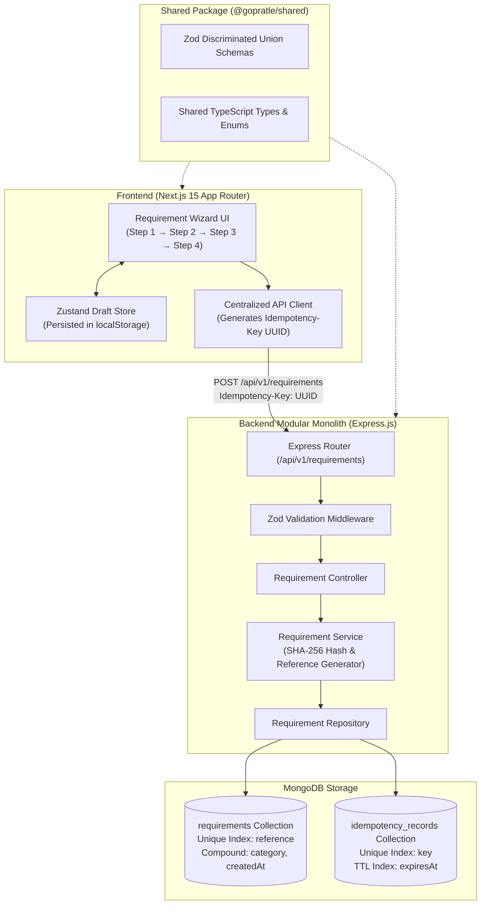

# GoPratle — Event Requirement Studio
### Full-Stack Requirement Management Platform

[](https://github.com/GoPratle/gopratle/actions/workflows/ci.yml)


---

## 1. Project Overview

**GoPratle — Event Requirement Studio** is an editorial, production-grade requirement-posting platform that enables event organizers to describe their needs with high precision and connect with verified service professionals across three core categories:

1. **Event Planner** — Full/partial planning, day-of coordination, decor styling, catering, and vendor logistics.
2. **Performer** — Vocalists, DJs, live bands, instrumentalists, comedians, and entertainment hosts.
3. **Crew** — Sound engineers, lighting technicians, camera operators, stage managers, and security staff.

The application delivers a dynamic, schema-driven multi-step wizard where every question automatically adapts to the chosen service category while guaranteeing end-to-end data integrity, idempotent submission handling, and zero state loss.

---

## 2. Key Features

- **Dynamic, Schema-Driven Multi-Step Wizard**:
  - **Step 1 (Event Basics)**: Event name, type, single vs. multi-day date picker with past-date rejection, city, venue, and visually distinct category selector.
  - **Step 2 (Primary Requirements)**: Dynamically renders category-specific fields (e.g. planner services & guest count, performer type & set duration, crew roles & shift hours).
  - **Step 3 (Additional Requirements)**: Collects custom constraints, genre/dress codes, plus contact information.
  - **Step 4 (Structured Review & Direct Editing)**: Modular summary with deep-edit links that jump directly to any step without erasing in-progress draft data.
- **Durable Client Draft Persistence**: Form progress persists safely across page refreshes in `localStorage` and cleans up immediately upon verified server confirmation.
- **Enterprise-Grade Backend Idempotency**:
  - Every submission attempt transmits a client-generated UUID via `Idempotency-Key`.
  - Backend maintains an atomic `idempotency_records` collection with SHA-256 canonical payload hashing and MongoDB TTL auto-expiry.
  - Duplicate submissions replay the original response; differing payloads sharing a key trigger `HTTP 409 Conflict`.
- **Modular Monolith Architecture**: Clean separation across Routes, Validation, Controllers, Services, Repositories, and Mongoose Models.
- **Zero Contract Drift**: Centralized `@gopratle/shared` package houses cross-application Zod schemas and TypeScript discriminated unions.
- **Security & Reliability**: Strict schema mode, Helmet security headers, CORS allowlists, IP rate limiting, and zero exposure of private contact details in public endpoints.

---

## 3. Technology Stack

### Frontend (`apps/web`)
- **Framework**: Next.js 15 (App Router, Server & Client Components)
- **UI Library**: React 19, Tailwind CSS, shadcn/ui primitives
- **Form & Validation**: React Hook Form, Zod (`@hookform/resolvers/zod`)
- **State Management**: Zustand with persistent storage middleware
- **Icons & Feedback**: Lucide React, Sonner (rich toasts)
- **Testing**: Vitest, React Testing Library, JSDOM

### Backend (`apps/api`)
- **Runtime**: Node.js 22 LTS, Express.js
- **Database**: MongoDB Atlas / MongoDB Server via Mongoose 8
- **Validation**: Zod (strict schema enforcement)
- **Security**: Helmet, CORS, express-rate-limit
- **Logging**: Pino (structured JSON logging, sanitized payloads)
- **Testing**: Vitest, Supertest

### Shared (`packages/shared`)
- **Validation**: Zod schemas with discriminated unions
- **Constants & Enums**: Event types, service categories, budgets, and roles
- **Type Definitions**: End-to-end shared TypeScript contracts

---

## 4. Architecture Diagram



---

## 5. Repository Structure

```
gopratle/
├── apps/
│   ├── web/                               # Next.js 15 App Router Frontend
│   │   ├── app/
│   │   │   ├── page.tsx                   # Editorial SaaS Landing Page
│   │   │   ├── requirements/
│   │   │   │   ├── new/page.tsx           # Multi-step Requirement Studio Wizard
│   │   │   │   └── success/[reference]/page.tsx # Confirmation & Reference Screen
│   │   │   ├── layout.tsx                 # Root layout with Navbar & Footer
│   │   │   └── globals.css                # Global Tailwind styling
│   │   ├── components/
│   │   │   ├── ui/                        # Button, Input, Textarea, Select, Badge, Card
│   │   │   ├── layout/                    # Navbar, Footer
│   │   │   └── requirements/              # WizardProgress, Header, Step components, Review
│   │   ├── lib/
│   │   │   ├── api-client.ts              # Fetch client with Idempotency header injection
│   │   │   └── utils.ts                   # Class merging helpers (cn)
│   │   ├── store/
│   │   │   └── requirement-store.ts       # Zustand store with category switching logic
│   │   └── tests/
│   │       ├── wizard.test.tsx            # 9 React Testing Library component tests
│   │       └── setup.ts                   # JSDOM & localStorage mocks
│   │
│   └── api/                               # Express.js Modular Monolith
│       ├── src/
│       │   ├── config/
│       │   │   ├── database.ts            # Mongoose pooling & lifecycle handlers
│       │   │   └── env.ts                 # Environment variable validation
│       │   ├── middleware/
│       │   │   ├── error-handler.ts       # Centralized RFC-compliant error formatter
│       │   │   ├── rate-limiter.ts        # IP rate limiting
│       │   │   ├── request-logger.ts      # Structured Pino logger (sanitized)
│       │   │   └── validate-request.ts    # Zod request validation middleware
│       │   ├── modules/
│       │   │   └── requirements/
│       │   │       ├── requirement.model.ts      # Mongoose schemas & indexes
│       │   │       ├── requirement.routes.ts     # Route declarations
│       │   │       ├── requirement.controller.ts # HTTP transport layer
│       │   │       ├── requirement.service.ts    # Business logic & idempotency
│       │   │       ├── requirement.repository.ts # Database persistence layer
│       │   │       ├── requirement.types.ts      # Module DTOs
│       │   │       └── requirement.validation.ts # Route validation schemas
│       │   ├── utils/
│       │   │   ├── ApiError.ts            # Standardized application error class
│       │   │   └── ApiResponse.ts         # Uniform JSON response utility
│       │   ├── app.ts                     # Express application definition
│       │   └── server.ts                  # Server entry & graceful shutdown
│       └── tests/
│           └── requirement.api.test.ts    # 14 Supertest integration tests
│
├── packages/
│   └── shared/                            # Reusable contracts & constants
│       └── src/
│           ├── constants/index.ts         # Categories, event types, budgets, roles
│           ├── schemas/requirement.schema.ts # Zod schemas with discriminated unions
│           └── types/index.ts             # Derived TypeScript interfaces
│
├── .github/
│   └── workflows/ci.yml                   # Automated GitHub Actions CI workflow
├── package.json                           # Root monorepo workspace scripts
├── pnpm-workspace.yaml                    # Workspace definition
├── tsconfig.base.json                     # Shared TypeScript configuration
└── README.md
```

---

## 6. Database Design & Indexing

All requirement records are persisted into a single, unified `requirements` collection with category-discriminated structures. Idempotent requests are coordinated via `idempotency_records`.

### `requirements` Collection
```json
{
  "_id": "673cf581...",
  "reference": "GPR-A81F92C4",
  "category": "planner",
  "status": "submitted",
  "event": {
    "eventName": "Annual Tech Conference 2027",
    "eventType": "corporate-event",
    "startDate": "2027-04-15",
    "endDate": "2027-04-17",
    "location": "Jaipur",
    "venue": "Convention Centre"
  },
  "categoryDetails": {
    "services": ["complete-event-planning", "decoration-styling"],
    "guestCount": 300,
    "budget": "3lakh-5lakh",
    "planningScope": "full-planning"
  },
  "additionalDetails": {
    "description": "Technology summit with 2 parallel breakout tracks.",
    "specialRequirements": "Curfew at 10 PM.",
    "preferredTheme": "Minimalist Tech"
  },
  "contact": {
    "name": "Sarah Miller",
    "email": "sarah@example.com",
    "phone": "9876543210"
  },
  "createdAt": "2027-01-01T10:00:00.000Z",
  "updatedAt": "2027-01-01T10:00:00.000Z"
}
```

#### Indexes:
1. `{ reference: 1 }` — **Unique** index for fast, collision-free lookups.
2. `{ category: 1, createdAt: -1 }` — **Compound** index for category-based filtering.
3. `{ status: 1, createdAt: -1 }` — **Compound** index for administrative lifecycle queries.

### `idempotency_records` Collection
```json
{
  "key": "c38a2e49-8c6f-4749-bbd1-561b3c95973e",
  "requestHash": "6b86b273ff34fce19d6b804eff5a3f5747ada4eaa22f1d49c01e52ddb7875b4b",
  "response": {
    "reference": "GPR-A81F92C4",
    "category": "planner",
    "status": "submitted",
    "createdAt": "2027-01-01T10:00:00.000Z"
  },
  "createdAt": "2027-01-01T10:00:00.000Z",
  "expiresAt": "2027-01-02T10:00:00.000Z"
}
```

#### Indexes:
1. `{ key: 1 }` — **Unique** index for constant-time idempotency resolution.
2. `{ expiresAt: 1 }` — **TTL** index (`expireAfterSeconds: 0`) for automatic background document purging.

---

## 7. REST API Documentation

Base URL: `/api/v1`

### 1. Health Check
`GET /api/v1/health`

**Response (`200 OK`)**:
```json
{
  "success": true,
  "message": "API is healthy",
  "data": {
    "status": "ok",
    "timestamp": "2027-01-01T10:00:00.000Z",
    "uptime": 124.5
  }
}
```

### 2. Create Requirement
`POST /api/v1/requirements`

**Headers**:
```http
Content-Type: application/json
Idempotency-Key: <unique-client-generated-uuid>
```

**Request Body (Example: Planner)**:
```json
{
  "category": "planner",
  "event": {
    "eventName": "Annual Tech Conference 2027",
    "eventType": "corporate-event",
    "startDate": "2027-04-15",
    "endDate": "2027-04-17",
    "location": "Jaipur",
    "venue": "Convention Centre"
  },
  "categoryDetails": {
    "services": ["complete-event-planning", "decoration-styling"],
    "guestCount": 300,
    "budget": "3lakh-5lakh",
    "planningScope": "full-planning"
  },
  "additionalDetails": {
    "description": "Technology summit with 2 parallel tracks.",
    "specialRequirements": "Curfew at 10 PM.",
    "preferredTheme": "Minimalist Tech"
  },
  "contact": {
    "name": "Sarah Miller",
    "email": "sarah@example.com",
    "phone": "9876543210"
  }
}
```

**Response (`201 Created`)**:
```json
{
  "success": true,
  "message": "Requirement submitted successfully",
  "data": {
    "reference": "GPR-A81F92C4",
    "category": "planner",
    "status": "submitted",
    "createdAt": "2027-01-01T10:00:00.000Z"
  }
}
```

### 3. Retrieve Safe Requirement Details
`GET /api/v1/requirements/:reference`

Returns a safe public representation of the requirement (**omits private contact details**).

**Response (`200 OK`)**:
```json
{
  "success": true,
  "message": "Requirement retrieved successfully",
  "data": {
    "reference": "GPR-A81F92C4",
    "category": "planner",
    "status": "submitted",
    "event": {
      "eventName": "Annual Tech Conference 2027",
      "eventType": "corporate-event",
      "startDate": "2027-04-15",
      "endDate": "2027-04-17",
      "location": "Jaipur",
      "venue": "Convention Centre"
    },
    "categoryDetails": {
      "services": ["complete-event-planning", "decoration-styling"],
      "guestCount": 300,
      "budget": "3lakh-5lakh",
      "planningScope": "full-planning"
    },
    "additionalDetails": {
      "description": "Technology summit with 2 parallel tracks."
    },
    "createdAt": "2027-01-01T10:00:00.000Z"
  }
}
```

### 4. List Requirements (Filter & Pagination)
`GET /api/v1/requirements?category=planner&status=submitted&page=1&limit=10`

---

## 8. Local Setup & Running Instructions

### Prerequisites
- **Node.js**: v20 or v22 LTS
- **pnpm**: v10 or v11 (`corepack enable && corepack prepare pnpm@latest --activate`)
- **MongoDB**: Local MongoDB instance or free MongoDB Atlas cluster

### 1. Clone & Install Dependencies
```bash
git clone https://github.com/GoPratle/gopratle.git
cd gopratle

# Install monorepo dependencies
pnpm install
```

### 2. Configure Environment Variables
Copy the sample environment files:

```bash
# Backend Environment
cp apps/api/.env.example apps/api/.env

# Frontend Environment
cp apps/web/.env.example apps/web/.env.local
```

### 3. Build Shared Packages
```bash
pnpm --filter @gopratle/shared build
```

### 4. Start Development Servers
Run frontend and backend simultaneously or in separate terminal tabs:

```bash
# Start backend API (runs on http://localhost:5000)
pnpm dev:api

# In another terminal, start Next.js web application (runs on http://localhost:3000)
pnpm dev:web
```

---

## 9. Automated Testing

All tests are verified and runnable from the repository root:

```bash
# Run all tests across shared, backend, and frontend
pnpm test

# Run backend API integration tests only (14 tests)
pnpm test:api

# Run frontend wizard component tests only (9 tests)
pnpm test:web
```

### Test Suite Summary:
- **Shared Package (`packages/shared`)**: 6 tests verifying Zod discriminated unions, date boundary checks, and strict unknown field rejection.
- **Backend API (`apps/api`)**: 14 integration tests verifying health check, planner/performer/crew persistence, validation errors, invalid date ranges, duplicate idempotency caching, 409 conflict detection, and public privacy guarantees.
- **Frontend Web (`apps/web`)**: 9 React Testing Library tests verifying step validation, category field switching, step navigation data preservation, category reset mechanics, review screen data rendering, successful redirect, and API failure draft preservation.

---

## 10. Architectural Decisions & System Design

### Decision 1: Modular Monolith over Microservices
The domain model focuses cleanly on **Event Requirement Management**. Introducing multiple distributed microservices would generate excessive operational latency, complex inter-service messaging, distributed transactions, and deployment friction without any workload justification. A modular monolith enforces strict domain boundaries while keeping development and deployment straightforward.

### Decision 2: Single Collection with Discriminators
All event requirements share common event metadata, contact fields, lifecycle statuses, and timestamps. Storing planner, performer, and crew requirements in a single `requirements` collection eliminates redundant collections while allowing discriminated subschemas to enforce strict, category-specific fields.

### Decision 3: Shared Validation Contracts (`@gopratle/shared`)
Duplicating validation schemas between Next.js and Express leads to contract drift. Placing Zod schemas in a shared package provides single-source-of-truth type safety from the browser input fields directly to the database layer.

### Decision 4: Idempotent Submission Architecture
Network timeouts and duplicate form submissions are frequent real-world challenges. GoPratle protects against duplicate records by deriving a SHA-256 canonical hash of the request payload and persisting it alongside a client-provided `Idempotency-Key` UUID. Repeated clicks return the cached success response seamlessly without duplicate database records.

### Decision 5: Why Redis and Message Brokers Were Intentionally Excluded
There is currently no high-throughput caching, background worker queue, or cross-node synchronization workload that justifies the operational cost of Redis or RabbitMQ. MongoDB's native TTL indexes manage idempotency expiration cleanly. Should asynchronous email dispatch or vendor matching be introduced in future phases, the service layer is architected to adopt the **Transactional Outbox Pattern** to ensure zero event loss between database transactions and message brokers.

---

## 11. Known Limitations & Future Roadmap

### Known Limitations
- The current implementation targets organizer submission; an administrative authentication layer (JWT/OAuth) will be needed for partner login.
- Date selections are standardized to ISO calendar dates without granular per-hour call time scheduling.

### Future Improvements
1. **Transactional Outbox & Asynchronous Notifications**: Add an outbox collection to dispatch confirmation emails to organizers and alerts to vendors.
2. **AI-Powered Requirement Parser**: Automatically pre-fill the wizard fields from unformatted organizer emails or voice notes.
3. **Vendor Bid Matching Engine**: Algorithmic scoring that routes submitted requirements to the top 5 relevant vendors based on verified budget and location proximity.
